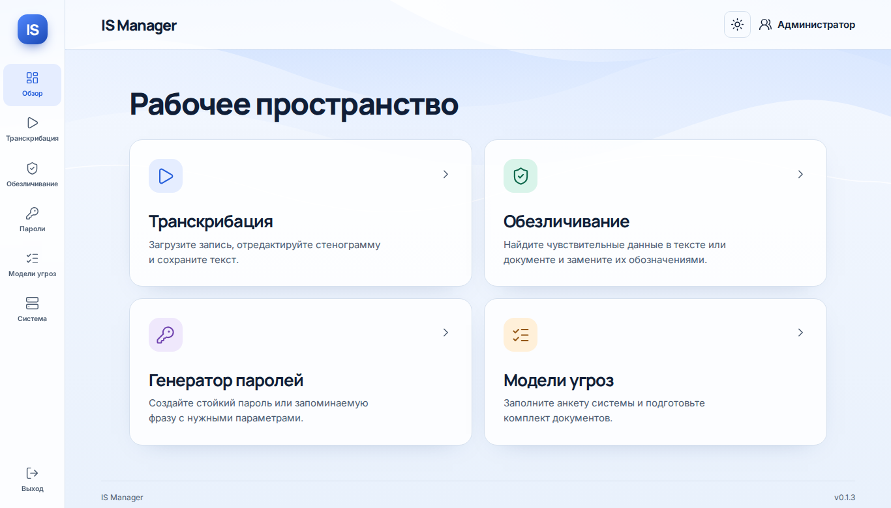

# IS Manager

IS Manager объединяет четыре инструмента для работы специалиста по информационной безопасности. Сервер обрабатывает рабочие материалы локально. После первой загрузки моделей распознавание речи и обезличивание работают без сетевых API.

| Раздел | Результат |
| --- | --- |
| Транскрибация | Стенограмма русской аудио- или видеозаписи с пунктуацией, редактором и экспортом |
| Обезличивание | Замена чувствительных фрагментов в тексте и файлах, предварительный просмотр, экспорт и история |
| Пароли | Семь вариантов в четырёх режимах, включая словосочетания и случайные символы. Генерация в браузере или на своём сервере |
| Модели угроз | Пошаговая анкета, расчёт по каталогу угроз, импорт и экспорт XLSX, комплект документов DOCX |



## Установка на Ubuntu

На чистой Ubuntu 24.04 с доступом в интернет скачайте установщик из релиза. Для сборки и работы на CPU ориентируйтесь на 4 ядра, 8 ГиБ ОЗУ и 20 ГиБ свободного места плюс пространство для записей и резервных копий. Точный расход зависит от длительности записей, объёма хранилища и частоты обновлений.

```sh
wget -O install-ismanager.sh https://raw.githubusercontent.com/calleograph/ismanager/main/install.sh
sudo bash install-ismanager.sh
```

Установщик клонирует стабильную версию в `/opt/ismanager`, собирает веб-приложение и обработчик GigaAM, проверяет их готовность, создаёт локальную запись `admin` и выводит одноразовый начальный пароль в терминал. Смените его при первом входе. Повторная установка сохраняет данные и пароль.

По умолчанию HTTPS слушает на `127.0.0.1:18443`. Для удалённого доступа к такой установке используйте SSH-туннель. Замените `user@server` своим SSH-адресом и откройте [IS Manager](https://localhost:18443) в браузере.

```sh
ssh -L 18443:127.0.0.1:18443 user@server
```

Для установки с доступом по сети укажите `--bind 0.0.0.0 --host ismanager.example.org`. При первом запуске создаётся собственный сертификат. Порядок подключения доверенного сертификата описан в руководстве администратора. На сервере с другими проектами используйте `--shared-host` с уже установленными Docker Engine и Compose v2. Можно задать другой порт (`--port`), каталог (`--dir`) и имя проекта Compose (`--name`).

## Обновление

В **Система → Обновления и резервные копии** нажмите **Проверить**, затем **Обновить**. Помощник получает релизный тег из GitHub, сохраняет копию данных, переключает версию, собирает образы и ждёт готовности сервисов. Те же операции доступны в каталоге установки.

```sh
cd /opt/ismanager
sudo ./scripts/manage.py check
sudo ./scripts/manage.py update
sudo ./scripts/manage.py status
```

## Руководства

- [Эксплуатация, настройки LDAP, резервные копии и восстановление](docs/ADMIN.md)
- [Архитектура, карта исходных проектов и разработка](PROJECT.md)
- [Транскрибация, модели и GPU](docs/TRANSCRIPTION.md)
- [Обезличивание и генератор паролей](docs/TEXT_TOOLS.md)
- [Генератор моделей угроз](docs/threats.md)
- [Сторонние компоненты и лицензии](docs/LICENSES.md)
- [Фактические проверки первого выпуска](docs/VERIFICATION.md)
- [Изменения версий](CHANGELOG.md)

Исходный код IS Manager распространяется под Apache License 2.0. Модели и сторонние компоненты сохраняют собственные условия. [Лицензия](LICENSE) · [Уведомления](NOTICE)
