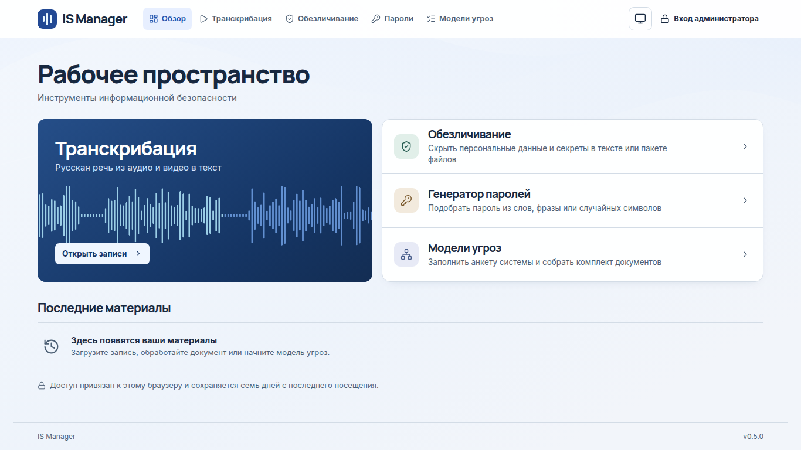

# IS Manager

IS Manager объединяет четыре инструмента для работы специалиста по информационной безопасности. Главное меню и все четыре раздела открываются без входа. Рабочие материалы видны только в браузере владельца или в учётной записи, под которой они созданы. Для системных настроек требуется вход администратора. Сервер обрабатывает материалы локально. После первой загрузки моделей распознавание речи и обезличивание работают без сетевых API.

| Раздел | Результат |
| --- | --- |
| Транскрибация | Ручная загрузка записей и наблюдение за локальными или SMB-папками. Стенограмма русской речи, TXT с тайм-кодами |
| Обезличивание | Один выбор файлов для отдельного документа и пакета. Полный профиль по умолчанию, отдельные TXT и ZIP готовых результатов, автоматическая обработка локальной и SMB-папки |
| Пароли | Семь вариантов в четырёх режимах, включая словосочетания и случайные символы. Генерация в браузере или на своём сервере |
| Модели угроз | Пошаговая анкета, расчёт по каталогу угроз, импорт и экспорт XLSX, комплект документов DOCX |

В руководстве собраны инструкции для сотрудников и администраторов. [GitHub Wiki](https://github.com/calleograph/ismanager/wiki) · [Версия на GitHub Pages](https://calleograph.github.io/ismanager/) · [Исходные статьи](wiki/Home.md)

Откройте нужный инструмент на странице **Обзор**. В разделе **Последние материалы** можно вернуться к личной записи, отдельному результату обезличивания, пакету файлов или к сохранённому шагу анкеты модели угроз. На телефоне рабочие разделы доступны в верхней строке навигации. При работе с клавиатуры первая ссылка **К содержанию** переводит фокус к текущей странице.



Сценарии рабочего пространства, снимки до и после изменений и замеры собраны в [отчёте об интерфейсе](docs/UX_FULL_AUDIT.md).

## Установка на Ubuntu

Для сборки и работы на CPU ориентируйтесь на 4 ядра, 8 ГиБ ОЗУ и 20 ГиБ свободного места плюс пространство для записей и резервных копий. База SQLite создаётся автоматически в постоянном Docker-томе приложения. Подключение отдельного сервера БД и создание базы администратором не требуются. Скачайте установщик и выберите команду для своего сервера.

```sh
wget -O "$HOME/install-ismanager.sh" https://raw.githubusercontent.com/calleograph/ismanager/main/install.sh
```

| Куда устанавливаете | Команда |
| --- | --- |
| На выделенную Ubuntu 24.04. Установщик при необходимости поставит Git, Python, Docker, Compose v2 и Buildx | `sudo bash "$HOME/install-ismanager.sh" --access http` |
| Рядом с работающими сервисами Docker. Укажите свободный порт, например 18085 | `sudo bash "$HOME/install-ismanager.sh" --shared-host --access http --port 18085` |
| За существующим Nginx, внешний HTTP-порт 8106, внутренний 18086. Подставьте своё имя или IP | `sudo bash "$HOME/install-ismanager.sh" --shared-host --access proxy --bind 127.0.0.1 --port 18086 --public-url http://ismanager.example.org:8106` |

Установщик клонирует стабильную версию в `/opt/ismanager`, собирает веб-приложение и обработчик GigaAM, проверяет их готовность, создаёт локальную запись `admin` и выводит одноразовый начальный пароль в терминал. Смените его при первом входе. Повторная установка сохраняет данные и пароль.

Для Nginx направьте запросы внешнего виртуального хоста на указанный внутренний порт. [Пример HTTP-конфигурации](docs/nginx-http.conf.example)

Установщик напечатает адрес для входа с другого компьютера той же сети. При HTTP без явного порта он имеет вид `http://192.168.1.25:18084/`, а с `--port 18085` — `http://192.168.1.25:18085/`. Вход, загрузка файлов и все четыре инструмента работают по HTTP. Пароли и рабочие материалы передаются открытым текстом, поэтому этот режим предназначен для доверенной локальной сети или VPN. Для сервера с несколькими сетевыми интерфейсами укажите нужный адрес через `--bind`.

Когда будет готов обратный прокси, переключите существующую установку следующей командой. Подставьте домен, указанный в сертификате прокси.

```sh
sudo /opt/ismanager/install.sh --access proxy --host ismanager.example.org
```

При размещении Nginx на том же сервере он передаёт запросы на `http://127.0.0.1:18084`. Приложение проверяет адрес прокси и соответствие внешней схемы и имени настроенному публичному URL. Команда с `--host` выбирает HTTPS. Учётные записи, результаты и модели сохраняются. После переключения с HTTP войдите заново. [Настройка сети и прокси](docs/ADMIN.md#сетевой-доступ) · [Пример для Nginx](docs/nginx.conf.example)

На общем сервере наружу публикуется только выбранный порт веб-приложения. Worker GigaAM доступен внутри проекта. Установка без сетевых параметров использует прямой HTTPS на `127.0.0.1:18443`. При обновлении сохраняется текущий адрес. [Размещение на общем сервере](docs/ADMIN.md#размещение-на-общем-сервере)

## Обновление

Если при установке выбран `--no-operator`, обновляйте экземпляр командами ниже. Чтобы включить кнопки на общем сервере, выполните `sudo ./install.sh --shared-host --operator` в каталоге установки. При работающем помощнике в **Система → Состояние → Обновления и резервные копии** нажмите **Проверить**, затем **Обновить**. Помощник получает релизный тег из GitHub, сохраняет копию данных, переключает версию, собирает образы и ждёт готовности сервисов. Те же операции доступны в каталоге установки.

```sh
cd /opt/ismanager
sudo ./scripts/manage.py check
sudo ./scripts/manage.py update
sudo ./scripts/manage.py status
```

## Руководства

- [Эксплуатация, настройки LDAP, резервные копии и восстановление](docs/ADMIN.md)
- [Архитектура, карта исходных проектов и разработка](PROJECT.md)
- [Транскрибация, модели и GPU](docs/TRANSCRIPTION.md)
- [Подключение SMB и автоматическая расшифровка записей из папки](docs/TRANSCRIPTION.md#наблюдение-за-папками)
- [Обезличивание и генератор паролей](docs/TEXT_TOOLS.md)
- [Генератор моделей угроз](docs/threats.md)
- [Сторонние компоненты и лицензии](docs/LICENSES.md)
- [Производительность и Ponytail-аудит](docs/PERFORMANCE_AUDIT.md)
- [Фактические проверки выпусков](docs/VERIFICATION.md)
- [Изменения версий](CHANGELOG.md)

Исходный код IS Manager распространяется под Apache License 2.0. Модели и сторонние компоненты сохраняют собственные условия. [Лицензия](LICENSE) · [Уведомления](NOTICE)
