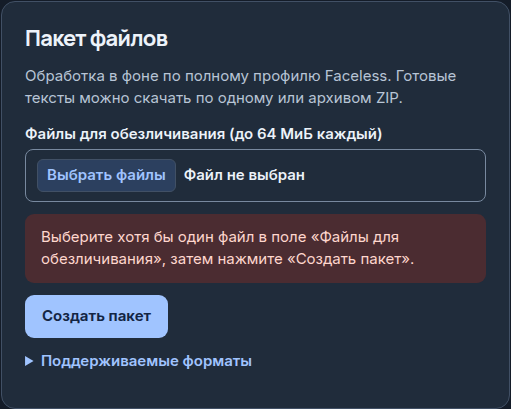

# Как обезличить документ или пакет заявок

Если нужно проверить один фрагмент заявки, откройте **Обезличивание**, вставьте его в **Исходный текст** и нажмите **Предпросмотр без сохранения**. Вместо вставки можно выбрать один файл до 12 МиБ. Если в тексте больше 60 000 знаков, разделите его на части или сохраните в TXT и обработайте в **Пакете файлов**. В форме по умолчанию выбран полный профиль Faceless. В результате видны число замен, их категории и обработанный текст.

Раскройте **Сравнить с исходным текстом** и проверьте имена, реквизиты и места, по которым можно узнать человека. Если результат подходит, нажмите **Сохранить результат**. На это есть 30 минут от создания предпросмотра. Сервер сохраняет проверенную редакцию, оригинал остаётся доступен для сравнения только в ответе, полученном при обработке. Для прямого сохранения из исходной формы есть кнопка **Обезличить и сохранить**.

## Несколько файлов одним пакетом

1. В блоке **Пакет файлов** нажмите на поле **Файлы для обезличивания**, выберите документы и нажмите **Создать пакет**. Список расширений находится под кнопкой в разделе **Поддерживаемые форматы**. В одном пакете можно сочетать TXT, CSV, Word, Excel и PDF. Для отдельных сканов предусмотрено распознавание русского и английского текста.
2. Оставьте вкладку открытой до конца передачи файлов. После приёма файлов сервер продолжает работу в фоне. Номер пакета поможет найти его в **Истории обработки**. Чтобы пополнить уже созданный пакет, раскройте **Добавить файлы**, выберите документы и нажмите **Добавить в пакет**.
3. Посмотрите строки **Результатов**. Повреждённый файл или документ, не прошедший независимую проверку, получит ошибку с пояснением. Остальные файлы продолжают обрабатываться. **Скачать готовые TXT в ZIP** собирает только уже готовые тексты. Для полного результата дождитесь завершения очереди.

При отправке без документов подсказка появляется рядом с полем **Файлы для обезличивания**. Здесь же можно выбрать файл и повторить отправку.

Если в браузере отключён JavaScript, выберите первый файл и нажмите **Создать пакет**. Остальные документы можно добавить по одному в открытом пакете.

В пакете всегда действует полный профиль. Предел каждого файла — 64 МиБ, извлечённого текста — 2 млн знаков, PDF — 300 страниц. Кнопка **Скачать TXT** в строке отдельного документа удобна, если требуется сразу посмотреть результат OCR. Нейтральные имена в архиве позволяют передать результат без фамилий и номеров заявок из исходных имён файлов.

Если эти документы регулярно появляются на файловом сервере, администратор может включить обработку всей папки. [Обработка папок](folders.md) · [Справочник форматов и экспорта](https://github.com/calleograph/ismanager/blob/v0.6.1/docs/TEXT_TOOLS.md#файлы-и-экспорт) · [В начало Wiki](Home.md)
