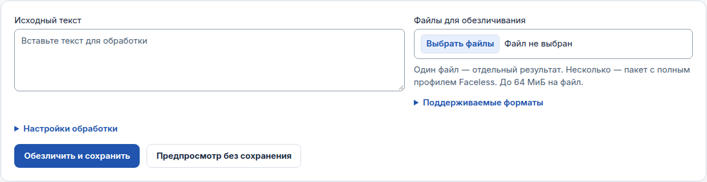

# Как обезличить документ или пакет заявок

Откройте **Обезличивание**, выберите один или несколько документов в поле **Файлы для обезличивания** и нажмите **Обезличить и сохранить**. Для одного файла откроется отдельный результат. Если выбрано несколько файлов, откроется пакет со строкой для каждого документа. Для текста из буфера обмена используйте поле **Исходный текст** и ту же кнопку.

Можно вставить до 60 000 знаков или выбрать документы до 64 МиБ каждый. Из файла извлекается до 2 млн знаков. Если отправить форму пустой, подсказка укажет, где выбрать файлы или вставить текст. Для сканов распознаётся русский и английский текст. Список расширений есть в разделе **Поддерживаемые форматы**.

## Проверить отдельный результат перед сохранением

Для вставленного текста или одного файла нажмите **Предпросмотр без сохранения**. В результате видны число замен и обработанный текст. Проверьте имена, реквизиты и места, по которым можно узнать человека. Для исходника до 60 000 знаков можно раскрыть **Сравнить с исходным текстом**. Если результат подходит, нажмите **Сохранить результат** в течение 30 минут после предпросмотра.

## Несколько файлов одним пакетом

В одном пакете можно сочетать TXT, CSV, Word, Excel и PDF. Дождитесь окончания передачи, после этого сервер продолжит обработку в фоне. Найти пакет можно по номеру в **Истории обработки**. Чтобы пополнить его, откройте **Добавить файлы**, выберите документы и нажмите **Добавить в пакет**.

Без JavaScript в одну отправку помещается до 128 МиБ. Если файлы вместе занимают больше, отправьте сначала два документа и добавьте остальные в открытый пакет.

В пакете действует полный профиль Faceless. Если один документ повреждён или проверка обнаружила остатки чувствительных данных, его строка покажет причину, а остальные документы продолжат обрабатываться. Кнопка **Скачать TXT** доступна у каждого готового результата. Чтобы получить весь пакет, дождитесь окончания обработки и нажмите **Скачать готовые TXT в ZIP**. В архиве используются нейтральные имена, поэтому фамилии и номера заявок из исходных имён туда не попадут.

Если документы регулярно появляются на файловом сервере, администратор может включить обработку всей папки. [Обработка папок](folders.md) · [Справочник форматов и экспорта](https://github.com/calleograph/ismanager/blob/v0.6.3/docs/TEXT_TOOLS.md#файлы-и-экспорт) · [В начало Wiki](Home.md)
