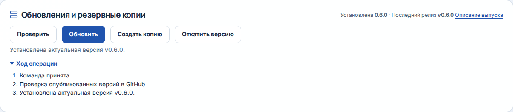

# Как обновить IS Manager и проверить результат

Если экземпляр уже установлен, выберите время, когда можно ненадолго прервать работу сотрудников. Сначала откройте **Система → Состояние → Обновления и резервные копии**. На первом обновлении с прежней версии вы увидите панель, которая поставлялась с этой версией. Описанный ниже экран с этапами доступен с 0.6.0.

## Когда помощник подключён

Нажмите **Проверить**. В панели показаны установленная версия и результат проверки GitHub. Если доступен подходящий выпуск, нажмите **Обновить** и подтвердите операцию. Раскройте **Ход операции**. Здесь появляются сообщения о выполненных этапах. По ссылке **Описание выпуска** можно прочитать, что вошло в найденную версию. Новые образы собираются до остановки действующих сервисов. Затем помощник делает резервную копию, переключает версию и проверяет готовность.

Пока веб-контейнер перезапускается, вкладка может временно потерять связь с сервером. Оставьте её открытой. Панель сохраняет последний полученный статус и возобновляет запросы после восстановления связи. Для продолжения работы в установленном выпуске нажмите **Открыть новую версию**. На прежней панели фактическую версию после обновления также можно узнать через `/healthz` на внешнем адресе.

На снимке показан результат команды **Проверить**. Сверху можно сравнить установленную версию с выпуском в GitHub, ниже — увидеть сообщение последней операции.



Чтобы поставить конкретный выпуск, запустите **установщик целевого выпуска** с хоста. Этот способ также подходит для первого перехода с 0.5.0 с предварительной сборкой. Для каталога `/opt/ismanager` на общем сервере с отключённым веб-помощником используйте следующие команды.

```sh
curl -fL https://raw.githubusercontent.com/calleograph/ismanager/v0.6.3/install.sh -o /tmp/ismanager-install-063.sh
sudo bash /tmp/ismanager-install-063.sh --dir /opt/ismanager --ref v0.6.3 --shared-host --no-operator
```

Укажите каталог своей установки. Если помощник уже подключён, опустите `--no-operator`.

## Если веб-управление отключено

Раскройте **Показать команды для сервера**. Если экземпляр установлен с `--no-operator`, операции доступны владельцу установки с хоста. Для обычной установки в `/opt/ismanager` выполните команды в каталоге проекта. При установке от имени отдельного пользователя используйте его права.

```sh
cd /opt/ismanager
sudo ./scripts/manage.py check
sudo ./scripts/manage.py update
sudo ./scripts/manage.py status
```

Если нужны кнопки в браузере, включите помощник от имени владельца установки. На общем сервере обычная команда для экземпляра, установленного с правами root, — `sudo ./install.sh --shared-host --operator` в его каталоге.

## Как проверить установку

Откройте `/healthz` через тот же внешний адрес, которым пользуются сотрудники. Ответ содержит `status: ok` и номер установленной версии. Откройте одну ранее сохранённую работу из **Последних материалов** в том браузере или под той учётной записью, где она была создана. Если обновление прервалось, прочитайте последнее сообщение панели или выполните `sudo ./scripts/manage.py status` на хосте, прежде чем запускать следующую операцию.

**Создать копию** позволяет отдельно сохранить состояние экземпляра. Копия содержит секрет приложения, базу и рабочие материалы, поэтому храните архив в месте с ограниченным доступом. Входные файлы и опубликованные TXT в общих папках копируются средствами самого файлового хранилища. Для возврата к прежнему выпуску есть команда **Откатить версию**. Перед возвратом сверьте последствия для работ, появившихся после обновления, и путь к подходящему архиву. [Состав копии и порядок восстановления](https://github.com/calleograph/ismanager/blob/v0.6.3/docs/ADMIN.md#резервные-копии-и-восстановление) · [В начало Wiki](Home.md)
